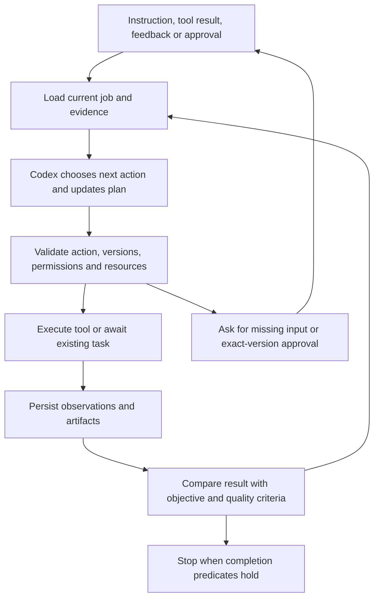

# Edie's agentic loop

Status: target contract, not implemented by the current render worker. One Edie
deployment is one agent with its own private editorial context. Video jobs are
persistent goals; render/index tasks are tools the agent can choose to use.

The proposed [versioned message and tool contracts](agent-contracts.md) specify
inputs, outputs, checkpoints and human-approval transitions for PR review.

## Decision cycle

Edie maintains a short editable plan, evidence references, unresolved questions,
quality criteria and a next-action decision. The plan is not a fixed pipeline:
new evidence may require denser visual inspection, different source selection,
script revision or a new render. Workflow stages define approval boundaries and
user-visible progress; they do not prescribe every action within a stage.

Every turn consumes the current job/revision, pinned deployment-context version,
recent events, selected source evidence, tool observations, remaining budgets and
human constraints. It emits a structured decision with a brief decision summary,
updated plan, input versions, expected outcome and exactly one action:

- `invoke_tool`: tool name, validated arguments and idempotency key.
- `await_task`: existing task ID; sleep until a completion/failure event, no polling
  through repeated model turns.
- `ask_human`: concrete missing information and why it prevents progress.
- `request_review`: exact candidate revision/artifact and scope of approval.
- `finish`: evidence supporting all completion predicates.
- `blocked`: named external dependency or exhausted resource/retry budget.

Store concise decisions and evidence, not hidden chain-of-thought. The coordinator
rejects malformed/stale decisions and returns a typed observation. It cannot replace
editorial judgement with a hardcoded next task, and the model cannot bypass its
permission, resource or human-approval checks.

## Tool contract and observation

Tools cover catalogue search, transcript retrieval, frame inspection, source-linked
script/timeline proposals, rendering, export inspection, subtitle adjustment,
handoff preparation and context-change proposals. Shell access remains available
inside the job sandbox, but external side effects and authoritative writes use
mediated tools. A tool result includes invocation/attempt IDs, success/failure,
artifact/evidence references, source and revision versions, measured usage and
validation findings. Tool completion returns to the decision cycle; it is not
synonymous with achieving the user's goal.

Long tasks run in the durable queue. The harness persists dispatch before execution
and associates completion with that invocation. On timeout it reconciles status
before retrying; it never starts another render just because the model forgot an
outstanding one. Tool errors distinguish invalid arguments, transient transport,
missing evidence, denied actions, resource exhaustion and uncertain completion.

## Evaluation, replanning and stopping

After a render, inspect the actual artifact and compare duration, structure,
source grounding, subtitles and visible defects with job criteria. A successful
FFmpeg exit alone does not satisfy editorial quality. For example, a requested
product demonstration may be absent: search the index, inspect candidate moments,
and revise the script if evidence exists; otherwise ask for footage or a changed
claim. Do not invent the demonstration to keep the loop moving.

Use configurable limits for turns, wall time, tool calls, repeated failures,
no-progress iterations, context size and spending. A new attempt must have a
reason to improve the outcome. Repeating the same action on identical inputs
without new evidence triggers a no-progress stop. Report achieved work, remaining
gaps and a concrete next requirement. No automatic metered fallback.

`finish` succeeds only when requested outputs exist, validation passes, required
human approvals match current versions and delivery is recorded. Awaiting review
is a parked job, not finalisation. A new instruction after finalisation starts an
explicit revision cycle; it does not silently invalidate an accepted master.

## Events, concurrent work and recovery

One decision writer per job serialises plan changes. Independent media tools may
run concurrently under resource reservations. Human feedback is durable and tied
to its revision. At the next safe boundary, incorporate new instructions and
replan; use expected-version checks so stale model output cannot overwrite newer
human edits. Cancellation terminates tools before acknowledgement; pausing parks
the goal and preserves accepted work.

A run checkpoint holds goal/criteria, plan version, context version, evidence
references, unresolved feedback, pending invocations and resource ledger. Resume
from these records and validated artifacts. A provider session is an optimisation,
not the source of truth. Context compaction keeps constraints, accepted changes,
open questions and evidence pointers; retrieve full evidence when needed. Deployment
context is shared between jobs; transient reasoning and unaccepted preferences are not.

## Acceptance scenarios

Use mocked tool/provider events for malformed decisions, stale revisions, lost
leases, uncertain requests, budget exhaustion and repeated-action loops. Use
synthetic media for deterministic timing/render checks. Use authorised real footage
for evidence selection, editorial self-correction, human review and finishing-app
handoff. Demonstrate: inspect → propose → render → observe defect → revise → render
→ request review; then feedback → targeted revision without loss of human changes.
Interrupt between dispatch and observation and show recovery without duplicate
publication. These scenarios test the agent, beyond isolated media utilities.
