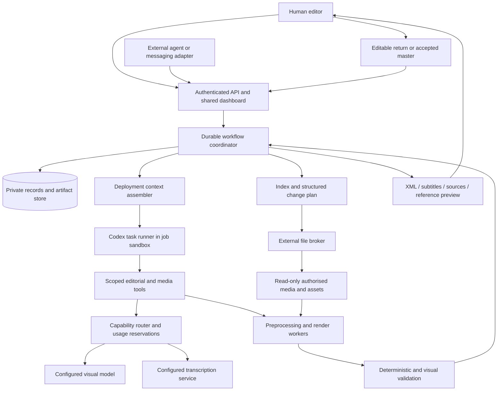

# Edie: video-editor assistant harness

Status: target architecture, with an implementation map below. This document
specifies the whole assistant, not just the render service. Proposed components
and contracts are not claims that they already work. The target must be accepted
on real authorised footage, including human handoff and recovery.

## Product boundary

Edie collaborates with people to turn footage into stories and actual edits.
Codex supplies the reasoning and tool-use runtime. Edie's harness supplies durable
state, context, capability routing, sandbox boundaries, validation and approval
gates. The language model proposes editorial work; the coordinator determines
whether that work is permitted and commits validated results.

Reusable application code is public. Deployment prompts, assets, footage, examples,
feedback, context and outputs remain private. An external broker owns remote
storage credentials and the mapping to originals. Edie receives authorised local
copies and returns artifacts and change proposals. It never applies remote file
changes or publishes content automatically.

## Components and trust boundaries

The diagram shows logical boundaries, not unrestricted network paths. The API
and coordinator may write authoritative state. Agent workers receive task-local
inputs and can write only staged results. They do not receive the management API
token, deployment credentials, storage credentials, host filesystem or Docker
socket. Render and preprocessing workers have no network requirement. Model
traffic goes through deployment-approved routes, with media payload permission
checked independently of tool/shell permission.

A future Codex worker must not share the current render worker's writable whole
state mount. The initial deterministic worker uses that mount as an implementation
shortcut; adding autonomous shell access requires per-task mounts and a mediated
result-commit boundary first.

## Records and ownership

| Record | Responsibility |
| --- | --- |
| Deployment context | One private editorial identity: prompts, brand/style assets, allowed capabilities and context versions; configured by the operator, not a project entity |
| Collection | Reusable footage set; can support multiple jobs without repeating analysis |
| Source version | Stable broker ID, immutable version/hash, local mapping and media metadata |
| Analysis chunk | Source interval, sampling/evidence, transcript or observations, model/settings version and coverage |
| Video job | Goal, audience, platform/format, duration, language, supplied script and requested deliverables |
| Script revision | Source-linked structure, dialogue references, missing footage and human replacements |
| Timeline revision | Clip/layer decisions, exact timing, asset dependencies and parent revision |
| Task/attempt | Typed action, input revision hashes, lease, checkpoint, usage, retry and failure records |
| Artifact | Kind, hash, storage reference, originating attempt/revision and validation results |
| Feedback | Job/revision, time basis and range, human text, resolution and provenance |
| Approval | Exact script/timeline/artifact version, scope, actor provenance and time |
| Human return | Base revision, imported timeline or master, dependencies and compatibility report |
| Learning change | Proposed context diff, accepted-feedback evidence, active version and reversal history |
| Broker proposal | Source versions, permitted scope, suggested destinations/names and expected conflicts |

Collections and analysis are independent of stories. Cutdowns are child jobs
linked to a specific approved parent artifact/revision. An edit never mutates the
revision reviewed by a human. Reference media time, timeline time and export time
are explicit coordinate systems with mappings; comments cannot silently migrate
to another revision after cuts.

## Editorial workflow and gates

1. **Define output.** Collect missing brief fields and supplied script. Select
   deployment context and authorised collection. A partial brief may remain a draft;
   do not invent the audience, purpose or promised facts to advance it.
2. **Index footage.** Validate broker manifests, hash local copies, reuse valid
   analysis, transcribe audio separately and analyse sampled visuals. Record
   coverage and uncertainty. Return index/transcripts and organisation proposals.
   Remote proposal application is a broker action, not an editing gate Edie can
   self-approve. See [visual pipeline](visual-analysis.md).
3. **Develop script.** Codex retrieves relevant source segments and proposes a
   source-linked script. Humans can replace it completely. Missing demonstrations,
   dialogue or facts become explicit gaps. Script approval binds the exact script.
4. **Build rough cut.** Compile an approved script to a validated timeline with
   B-roll, graphics, transitions and draft subtitles. Preserve verbatim transcript;
   store grammar corrections separately and flag uncertain names. Render an actual
   preview, not merely an editing plan.
5. **Review and revise.** Show revision/artifact-specific previews and accept
   timestamped feedback or human-editing returns. Apply edits as a new revision,
   preserving human choices. Require main-edit approval before derivatives.
6. **Create variants.** Use the approved main source of truth for requested lengths,
   aspect ratios and subtitle languages. Rework hooks/endings coherently, recalculate
   subtitles, and prepare covers and posting materials. Approval of the main does
   not automatically approve every derivative or publishing action.
7. **Validate and finalise.** Validate each export and package, resolve failures,
   obtain final approval for the exact deliverables and return them to the broker.
   Only then propose deployment-local learning from accepted feedback.

A job has a workflow stage and a separate execution status: waiting for input,
queued, running, paused, interrupted, failed, awaiting review or finalised. Task
completion cannot move a job across an unmet human gate. Changes to an approved
input invalidate downstream approvals, while preserving their historical records.

## Codex harness and reasoning loop

Edie is a goal-driven agent. Codex chooses the next editorial action from the
current evidence, uses tools, evaluates observations and revises its plan until
it reaches a human gate, completion or a concrete blocker. The coordinator
persists decisions and enforces boundaries; the render queue is a tool subsystem.
The [agentic-loop contract](agent-loop.md) defines decision outputs, observations,
replanning, stop conditions, steering and restart behaviour. It is target design;
the current code does not yet implement that agent loop.

One deployment owns one private context. There is no project entity or creation
endpoint. Jobs represent individual stories; reusable collections may support
several jobs. Deployment context is versioned and pinned per run. Codex workers
receive bounded evidence and task-local files, never whole-state write access.

## Model routing, credentials and spending

The [model-access contract](model-access.md) selects Codex CLI execution, local
multimodal chat and separate Whisper-compatible transcription adapters. Actual
addresses and model aliases are deployment-private; adapters are not implemented.

Routes are configured by capability: planning, visual observation, transcription,
editorial revision and review. Each route declares model/endpoint, supported input
kinds, context/frame limits, credential reference, billing mode and allowed payload
classes. Validate advertised capabilities with bounded tests before activation.
Visual support does not imply speech support, or native video support.

Prefer approved local models and included subscription use. No automatic switch
to metered services. A local proxy is not sufficient evidence of local-only routing:
its downstream/fallback policy must also satisfy the deployment configuration.
Cloud permission specifies which text, frames, audio or video may leave the sandbox.
Default-deny unconfigured routes. Worker network enforcement must match this policy;
a prompt instruction alone does not constrain arbitrary shell uploads.

Reserve a worst-case bounded request cost before dispatch, settle actual measured
usage afterwards and account for retries/failed attempts. Store tokens, audio/video
seconds, frame counts, latency, known charges and estimates separately. Unknown
cost is not zero. If a bounded charge cannot be established, block a metered request.
Per-video budgets also account for derivative jobs according to an explicit parent
budget allocation; parallel tasks cannot each spend the same unreserved balance.

Subscription renewal is a deployment-owned credential lifecycle, separate from
Edie's bearer token. Route credentials are supplied only where needed at runtime,
not copied into job context, Git, images, logs or artifact packages.

## Human editing and accepted sources of truth

[OpenTimelineIO](timeline.md) is the selected canonical timeline representation,
with sidecar subtitles and Edie records. The initial supported subset, render
compilation and FCP7 adapter integration remain to be implemented.

The [handoff and feedback contract](handoff-feedback.md) defines the initial
XML/SRT/media/MP4 package and broker-mediated shared-directory workflow.

The initial handoff contains FCP7 XML, per-language SRT, linked source media and
required assets, plus an MP4 reference. Package a dependency manifest and explicit
warnings for unsupported effects/styling. Validate an import/export round trip in
the actual finishing application/version before claiming compatibility.

An editable return creates a human-authored revision linked to its exported base.
Compare timing, source references, audio and subtitles; preserve human edits and
surface conflicts rather than silently recompiling the earlier script over them.
If only a finished master is returned and accepted, it becomes the authoritative
main artifact. Derivatives can use that master; requests needing missing editable
layers must ask for compatible assets. Never regenerate from an obsolete rough cut
and describe it as the accepted edit.

## Learning and context lifecycle

A versioned social-media/editorial strategy supplies audience, story and style
context. The [evaluation design](strategy-evaluation.md) separates technical,
workflow and human-calibrated editorial checks from later audience outcomes.

After final approval, derive candidate preference changes only from feedback that
was accepted for that output. Keep the evidence references and a readable context
diff. Activation produces a new deployment context version; operators can correct or
revert it. Jobs already in progress keep their selected context version unless an
explicit refresh creates a new revision. Rejected drafts and inferred preferences
are not silently learned. This updates context, not model weights, and does not
share lessons between deployments.

## API, dashboard and integrations

All entry points submit commands against the same records and state machine.
The dashboard shows stages, previews, artifacts, revision ancestry, unresolved
feedback, approvals, failures and usage. Messaging adapters translate messages
into the same commands; they do not own a parallel job state or bypass approval
binding. Preserve the origin of instructions and approvals. With a shared bearer
token, caller-supplied actor names are descriptive, not independently verified
human identities; a trusted interaction boundary is needed for human approval.

The [current API contract](api.md) documents existing endpoints only. The target
contract still needs typed instructions, broker imports, context versions,
script review, human-return ingestion, workflow transitions, delivery and learning
operations. Use idempotency keys and expected-revision preconditions for mutations;
return explicit state conflicts rather than overwriting newer human edits.

## Execution, recovery and deployment

The [storage policy](storage.md) defines proposed disk reservations, retention,
cleanup and context-window budgeting. These controls are not implemented yet.

Docker separates API/coordinator, deterministic media workers and isolated Codex
workers. Persist private metadata and artifacts across restarts; mount authorised
media/assets read-only. Deployment agents own installation, route configuration,
credential renewal, backups and upgrades. Editing workers never gain those powers.

Use leases and fenced commits for tasks. Cache analysis per source/settings/model
version and checkpoint completed chunks atomically. Distinguish retryable transport
failures from invalid evidence, denied capabilities and human-review gates. Pause
or cancel stops child processes before acknowledgement. Cancellation retains source
copies, outputs and accepted edits; it is not deletion authority.

Reconcile interrupted work against durable artifacts before rescheduling. A staged
artifact is not delivered merely because a file exists. Deterministic caches may be
reused after hash validation; model/provider requests with uncertain completion
must retain uncertainty and usage evidence rather than blindly replaying side effects.
See [current render worker](render-worker.md) for implemented lease behaviour and
its recovery limitations. Version schema migrations and test backup/restore before
claiming upgrade readiness; these lifecycle guarantees are not implemented yet.

## Implementation map and acceptance

| Area | Current state |
| --- | --- |
| Records/API | Basic jobs, revisions, feedback and approval intent; single operator token |
| Execution | Render queue, idempotency, leases, running pause/cancel, explicit recovery, artifact retrieval |
| Rendering | Hash-checked clips, 720p/30fps reference preview, audio required, duration/decode checks |
| Broker/index | Initial source catalogue and bounded frame preprocessing tested; no broker API or model analysis |
| Codex harness | Target design only; no Codex runner, context assembler or capability router |
| Editorial gates | Target design only; approval records do not enforce the complete workflow |
| Handoff/variants | Not implemented; finishing-app/version verification outstanding |
| Dashboard/learning/budgets | Not implemented |

Current render tests and a short authorised-footage preview demonstrate only a
technical rendering path. Acceptance must exercise a real brief, reusable indexing,
source-linked script approval, watchable edit, feedback revision, finishing-app
handoff/return, main approval, requested variants, validated delivery and reversible
learning. Interrupt and resume representative indexing, model and render tasks;
verify no duplicate charges/work publication or loss of accepted human changes.
The [implementation gates](implementation-gates.md) track remaining work. Operator
choices still include finishing application/version, subtitle languages, style
baseline and permitted cloud payloads; keep their actual values private.

## Next design contracts

Before expanding the agent implementation, specify:

1. Implement the [selected OTIO representation](timeline.md): precise timing,
   subtitle sidecars, render compilation and tested FCP7 XML round-trip behaviour.
2. Human authority: feedback-to-instruction rules, approval invalidation, conflict
   resolution and accepted human-return precedence.
3. Executable tool schemas and evaluation criteria: evidence requirements,
   tool outcomes, editorial improvement measures and bounded retry decisions.
4. Model adapters: actual Codex invocation/event protocol, vision/transcription
   capability tests, credential renewal, enforced egress and usage accounting.

Implement the first complete agent path before widening the feature surface:
inspect authorised footage → propose grounded script → human approval → render
→ inspect output → revise → request review. Validate controlled failures with
mocks and editorial quality with real footage. Storage management and production
hardening follow the same documented boundaries; neither is supplied merely by
a working render queue.
